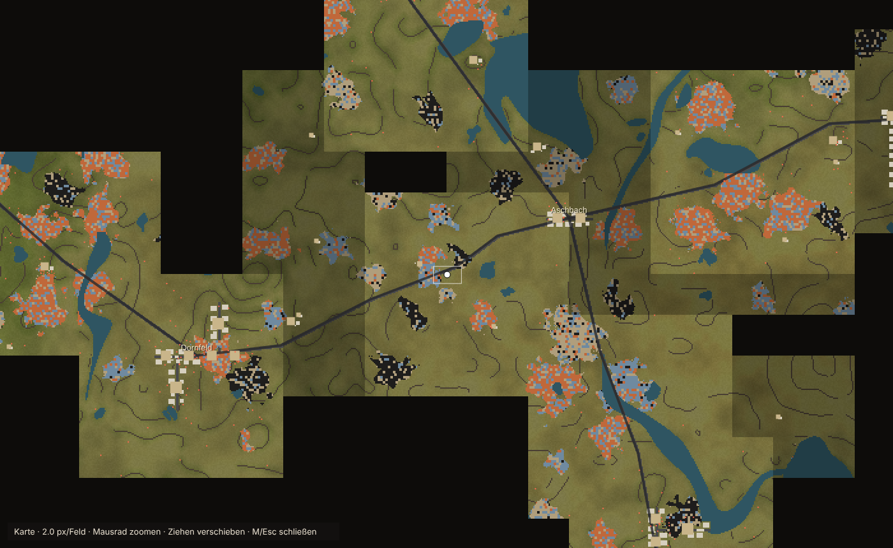

# Letzte Schicht

Ein 2D-Überlebensspiel im Browser: Die Welt ist untergegangen, Zombies streifen durch die Ruinen. Plündere
verlassene Häuser und Wracks, baue ein befestigtes Lager mit einer kleinen Produktion (Munition, Mauern,
MG-Türme) und rufe am Ende mit dem Funkturm die Rettung.

Grundlage ist das Fabrikspiel „Eisenwerk“ (`allgrinder/Webgame`, als `upstream` eingetragen): Bänder, Greifarme,
Öfen, Strom und Forschung sind geblieben, aber bewusst schlank gehalten. Dazu kommen Überleben, Beute, Lärm und
Horden. Vite + TypeScript (strict) + PixiJS, ohne Backend. Grafik vollständig per Skript aus Blender gerendert.

## Starten

```bash
npm install
npm run dev
```

| URL | Inhalt |
|---|---|
| http://localhost:5173/ | Freies Spiel in der festen Welt „Kreis Aschland“ („Weiterspielen“ bei vorhandenem Spielstand) |
| http://localhost:5173/?new&god | Gottmodus zum Ausprobieren (unsichtbar für Zombies, schnelles Bauen) |
| http://localhost:5173/?scene=demo | Produktionskette des Vorgängers (Testszene) |
| http://localhost:5173/?scene=sandbox | Sandkasten |

Parameter: `?seed=123` (anderes Gelände, Testhilfe), `?new` (ohne Startdialog), `&enemies=aus|wenig|normal|viele`,
`&death=endgueltig|wiedereinstieg`, `&debug`, `&warp=600`.

## Die Welt

Das Spiel hat **eine feste Welt**: den Kreis Aschland mit dem Weiler Aschbach, den Dörfern Dornfeld, Moorbrück und
Kaltenhain, den Städten Eisenrode (Industrie) und Grauenfurt (Kreisstadt) und dem Militärposten 7, verbunden durch
Landstraßen. Die Karte (**M**) zeigt Straßen und Ortsnamen von Anfang an. Wer stirbt, kommt mit einer neuen Figur in
dieselbe Welt zurück: Lager, geplünderte Häuser und die Leiche mit dem Inventar sind noch da.



## So läuft eine Runde

Die Schleife ist: **hinausgehen, plündern, kämpfen – und zurück zur bewachten Basis.**

1. **Basis gründen.** Das Lagerfeuer aus der Startausrüstung ist die Mitte deiner Basis: Hier startet nach dem Tod
   die nächste Figur, hierher ziehen die Horden, daneben schläft man gut. Die **Ziele** links oben führen durch die Runde.
2. **Plündern statt Bergbau.** Es gibt keine Minen. Material liegt als **Schrotthaufen** herum (Schrott, Schutt,
   Kohle, Holz, Autoteile, Elektroschrott) – am Startfundort, an Höfen, in Orten und auf eingezäunten
   **Schrottplätzen**. Rechtsklick halten schlachtet aus, das Brecheisen verdoppelt das Tempo. Häuser, Läden und
   Wracks werden durchsucht (Linksklick). Der Rucksack bringt 20 Plätze – trotzdem muss man oft heim.
   **Sammeltrupps:** Eine *Sammelstelle* schickt Sammler zu den Haufen im Umkreis; sie bringen Schrott heim, kosten
   Verpflegung und werden von Zombies gejagt.
3. **Überleben.** Hunger, Durst und Müdigkeit sinken ständig. Konserven und Wasser gibt es als Beute; auf Dauer
   helfen Gemüsebeet und Regentonne. Geschlafen wird mit **N** (im Feldbett erholsamer). Blutungen stoppt ein
   Verband, ein infizierter Biss endet ohne Antibiotika tödlich.
4. **Leise bleiben.** Lärm lockt Zombies an: Schüsse, Ausschlachten, Dampfmaschinen, Montagemaschinen. Nahkampf ist
   leise, Solarstrom auch. Der Lockvogel (Wurf) zieht Zombies von dir weg – oder in deine Fallen.
5. **Befestigen.** Ab Tag 2 zieht jede Nacht eine Horde zum Lagerfeuer, jede siebte Nacht eine große. Holzbarrikade,
   Steinmauer, Tor, Stacheldraht, Nagelfalle, MG-Turm und Wachturm halten sie auf. Nachts sehen Türme nur im Licht
   voll – Feuerschalen und Scheinwerfer aufstellen. **Versorgungsabwürfe** landen ab Tag 2 am Fallschirm: gute Beute,
   aber laut.
6. **Rettung.** Forschung „Funktechnik“, Funkteile aus Läden und Werkstätten, dann den Funkturm 15 Minuten unter
   Strom halten. Er ist sehr laut.

## Steuerung

- **WASD** laufen, **Mausrad** zoomen, **Leertaste** halten: angreifen, **X** Nahkampf ↔ Schusswaffe, **N** schlafen
- **Linksklick** bauen, durchsuchen, Gebäude öffnen; **Rechtsklick halten** abbauen, fällen, ausschlachten
- **Rechtsklick im Inventar** essen, trinken, verbinden (oder Gegenstand in die Hand und ins Freie klicken)
- **E** Inventar & Handwerk, **T** Forschung, **M** Karte, **J** Handbuch, **O** Strom, **P** Produktion
- **R** drehen, **Q** aufnehmen/Hand leeren, **1–0** Schnellleiste, **Alt** Detailansicht
- **V** in den Pritschenwagen ein-/aussteigen (W/S Gas/Bremse, A/D lenken); Wrack anklicken repariert ihn
- **Strg+S / Strg+L** speichern/laden, **Esc** Menü, **H** Hilfe

## Befehle

```bash
npm run build          # Typprüfung + Produktionsbuild nach dist/
npm test               # Vitest (Simulation, headless)
npm run e2e            # Playwright (Build + Vorschau-Server)
npm run assets         # Blender-Modelle rendern (nur geänderte) + Atlanten + manifest.json
npm run assets -- --only zombies,ruinen   # einzelne Modelle
```

`npm run assets` braucht Blender: entweder das Programm im `PATH` oder (bevorzugt) das Modul in einer venv:

```bash
python3 -m venv .venv-blender && .venv-blender/bin/pip install bpy==5.2.4 numpy
```

Die fertigen Assets in `public/assets/` sind eingecheckt; das Spiel läuft ohne Blender.

## Aufbau

- `src/data/` – alle Spieldaten: `enemies.ts` (Zombies, Lärm, Horden, Waffen), `survival.ts`, `loot.ts`, `tech.ts`, …
- `src/sim/` – deterministische Simulation mit 60 Ticks/s, ohne DOM und PixiJS: `enemies.ts` (Zombies),
  `noise.ts` (Lärm), `sites.ts` (Fundorte), `player.ts` (Überleben, Nahkampf), dazu Bänder, Strom, Forschung
- `src/render/` – PixiJS-Renderer, `src/ui/` – DOM-Overlay, `src/game/` – Spielschleife, Eingabe, Speichern
- `assets/blender/` – Blender-Skripte (`lib/zombie.py`, `ruinen.py`, `lager.py`, `kram.py`, `truemmer.py`, …)
- `docs/KONZEPT.md` – Spielkonzept, Werte und offene Punkte
